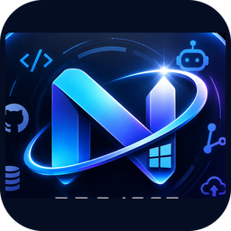
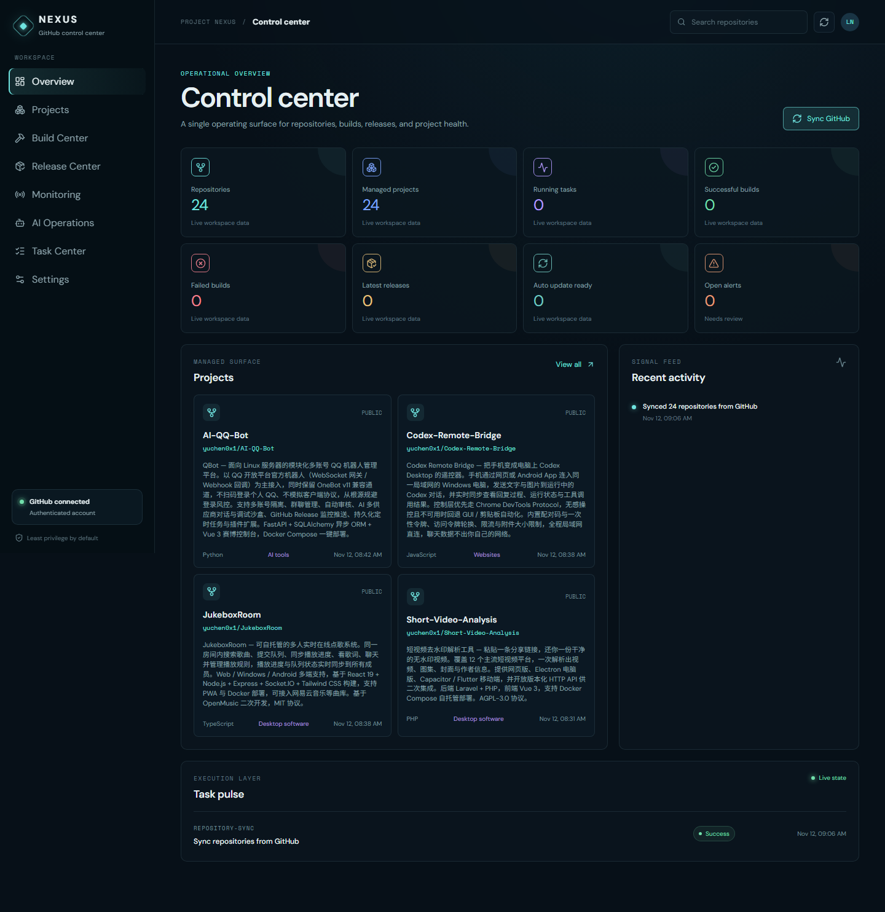

# PROJECT NEXUS

  

  
  
  
  
  

**Windows 桌面 AI 仓库运营中心。** 连接 GitHub 与 AI 网关，持续监控仓库，在独立 Worktree 中修复和验证问题，并按授权策略交付 PR 和版本。

**在线宣传页：[project-nexus.edgeone.dev](https://project-nexus.edgeone.dev/)**（源码位于 `website/`，纯静态、零依赖，通过 [EdgeOne Pages](https://pages.edgeone.ai/) 免费托管）

> **发布状态（如实说明）**：v0.8.6 为 Windows x64 开发预览，已进入应用内自动更新通道；安装包未签名，不是 v1.0 稳定版。下载前请通过发布页的 SHA256 校验文件核对完整性。

  

## 核心特性

- **七步教学上手**：首次启动自动进入教学，逐步说明连接 GitHub、配置 AI、选择仓库、检测工具和开启托管；工作台随时可重看「一键教学」。
- **批量仓库托管**：勾选多个仓库统一开启托管，逐仓库显示进度；归档仓库自动隐藏并标记状态。
- **AI 修复与验证**：Issue 巡检分类，符合条件的进入修复流程——隔离工作区修改、运行真实测试、独立审查，按策略交付。
- **明确授权边界**：脚本执行、远程写入、合并发布都需要逐项授权；未授权的操作不会发生。
- **应用内自动更新**：设置中一键检查更新，版本按数值从新到旧排列，应用内可直接查看更新日志。
- **十种语言界面**：简体中文、English、日本語等十种语言，深浅色与系统主题跟随。

## 三档授权策略

| 策略 | 行为 |
| --- | --- |
| 观察 | 监控、分析、报告，不自动修复 |
| 自动维护 | 隔离修复，验证后按策略推送分支和创建 PR |
| 全自主 | 还允许在验证与发布检查后合并、发布和条件关闭 Issue |

仓库策略与应用远程写入开关同时生效。工具、依赖、网络、权限或验证不满足时停止并保留证据；中断交付可在任务中心核对回执，后续处理仍需人工评估。

## 安装与首次使用

[下载当前公开版 Windows x64 安装包](https://github.com/yuchen0x1/PROJECT-NEXUS/releases/latest) · [版本说明与校验文件](https://github.com/yuchen0x1/PROJECT-NEXUS/releases/latest)。0.8.2 及更高安装版可在设置中点击「检查更新」直接升级。

1. 在 Windows 10 / 11 x64 上运行安装程序。
2. 首次启动自动打开教学；之后可从工作台或顶部的「一键教学」重新进入。
3. 使用 GitHub 访问令牌连接账号；已有 GitHub App 也可在远程控制台管理。
4. 输入 API 类型、Base URL 和 API Key，点击「获取模型」从下拉列表选择后保存并测试。
5. 勾选仓库，按下一步完成工具检测、统一策略与逐仓库检查。执行代码需要明确授权所选仓库的脚本。
6. 需要远程交付时，明确允许应用按各仓库策略写入 GitHub。
7. 如果全局巡检暂停，先明确恢复，再开启托管。

窗口关闭后可留在托盘运行；退出应用或关机后本机任务无法继续，开机启动由用户在设置中启用。后台是 Electron 管理的 Node 子进程，不安装 Windows 系统服务。缺少工具只检测，不自动安装 Ollama、Docker 或本地模型。

## 开发者运行

需要已安装的 Node.js、npm 和 Git。

    npm ci
    npm run desktop:dev

网页/API 开发使用 `npm run dev`；生产后端先 `npm run build` 再 `npm start`。环境模板见 `.env.example`；`npm start` 不自动加载 `.env`，需要时显式执行：

    node --env-file=.env server/index.mjs

不要提交真实凭据。默认 API 仅监听 127.0.0.1:4317；独立后端不具备公网多用户认证。

### 验证与构建

    npx tsc --noEmit
    npm test
    npm run build
    npm run i18n:audit
    npm run i18n:coverage
    npm run desktop:package:win

桌面冒烟、i18n 与质量回归脚本见 `tests/`。真实验收脚本 `tests/v1-live-acceptance.mjs` 要求真实 GitHub/AI 凭据和严格命名的临时测试仓库，会写入该仓库，不应指向业务项目。

## 数据与安全

桌面数据在 `%LOCALAPPDATA%\PROJECT NEXUS`：`state.json` 为 schema v4；`provider-keys.json` 与 `github-credentials.json` 保存 DPAPI 加密凭据；`repositories/` 与 `agent-workspaces/` 保存隔离工作区；`logs/` 与任务文件保存执行证据。

状态使用原子替换、上一份有效副本和迁移前快照。不会自动用备份覆盖当前数据；恢复前退出应用，复制当前数据并人工核对。

本机命令具有超时、程序允许列表与凭据环境过滤，**不是 Windows 操作系统安全沙箱**。只为可信仓库开启脚本执行。DPAPI 不能防御同一 Windows 用户权限下的恶意程序。当前 Windows 会话无法解密既有 GitHub / AI 凭据时，需在应用中重新连接；原凭据文件不会被覆盖。详见[安全说明](docs/SECURITY.md)。

## 验收与限制

完整的原生隔离宿主、签名安装/回滚、真实外部模型服务、24 小时连续验收**尚未完成**——不以历史成功或本地候选替代当前版本验收。当前能力矩阵见[验收矩阵](docs/TEST_ACCEPTANCE_REPORT.md)与[安全加固报告](docs/SECURITY_HARDENING_REPORT.md)；各版本已知限制见对应发布说明。

历史基线：0.3.0 在私有测试仓库通过了 Bug 复现、AI 修复、回归测试、构建、独立审查、推送、PR、合并与带校验资产的 Release 全链路（[历史测试报告](docs/V1_TEST_REPORT.md)）。0.7.0 起 CI 门禁下的真实交付闭环因 Checks API 权限受阻，属未完成项。

自动发布当前面向具有 `package.json` 且可运行 `npm test` 的项目；尚不是任意语言项目的通用发布器。

## 文档

- [用户指南](docs/USER_GUIDE.md) · [快速开始（中文）](docs/QUICK_START.zh-CN.md)
- [架构](docs/ARCHITECTURE.md) · [更新日志](CHANGELOG.md) · [完整发布记录](docs/releases/release-notes.md)
- [验收矩阵](docs/TEST_ACCEPTANCE_REPORT.md) · [安全说明](docs/SECURITY.md) · [Windows 桌面架构决策](docs/WINDOWS_DESKTOP_DECISION.md)
- [GitHub App 配置](docs/GITHUB_APP_SETUP.md) · [Webhook 配置](docs/GITHUB_WEBHOOKS.md)

## 许可证

[MIT](LICENSE) © 2026 冷漠不是神 (yuchen0x1)
