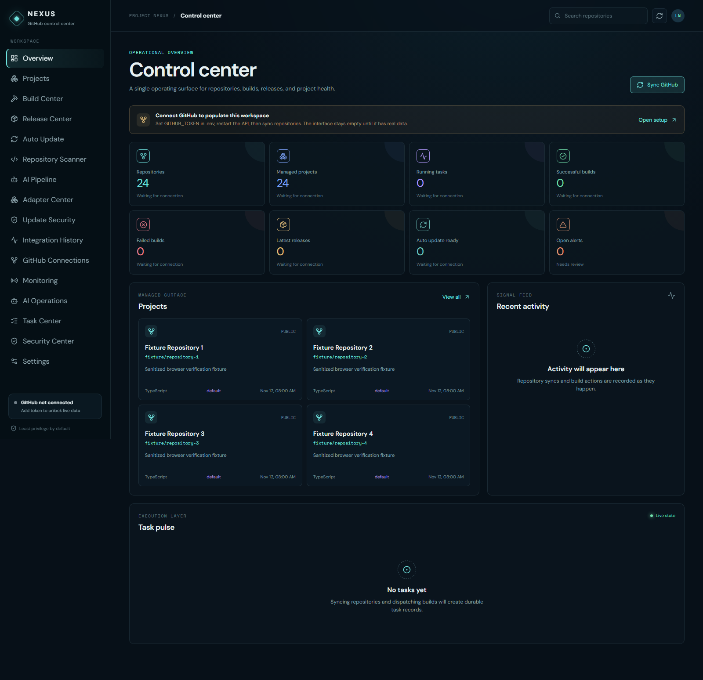
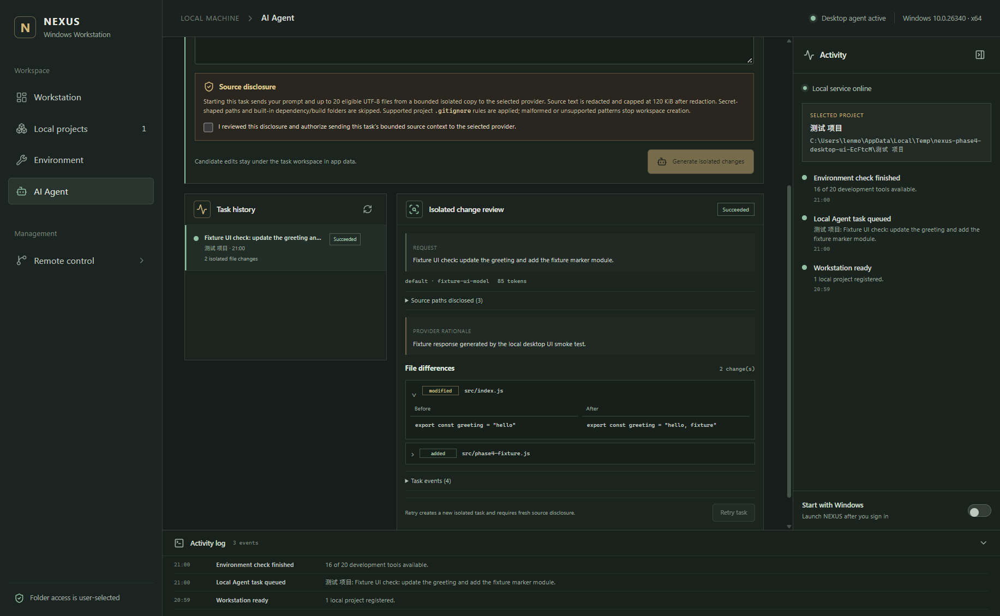

# PROJECT NEXUS

PROJECT NEXUS is a GitHub repository operations console with build and release workflows, update capability scanning, framework evidence adapters, and a guarded local AI change pipeline.

It uses React/Vite, Express, GitHub REST APIs and versioned JSON persistence. The frontend never receives GitHub or AI credentials. Missing integrations report explicit blocked states instead of fabricated results.

## Current capabilities

- Repository inventory sync from a GitHub token or configured GitHub App installation.
- Repository project views, GitHub Actions workflow/run lookup, and workflow dispatch.
- Release lookup, draft/edit/publish endpoints, asset upload and SHA-256 recording, with role and confirmation checks.
- Webhook HMAC validation, delivery deduplication and persisted event intake. Event processing still uses an in-process task runner.
- Commit-pinned update evidence scans and reports for Electron, Tauri, Python desktop, .NET and Web/PWA.
- Android and iOS project evidence detection, currently reported as unsupported because no mobile update adapters are implemented.
- Persisted scan history, bounded recurring scans, cancellation and retry controls.
- Optional AI change proposals in isolated per-repository workspaces, with selected source disclosure, file-operation limits, local diff review and container-based checks.
- Extensible AI provider registry with task routing, OpenAI-compatible/Ollama/Anthropic/Gemini request formats, bounded retry/timeout, usage normalization and optional cost estimation; provider keys remain server-side.
- Guarded AI diagnosis endpoint and non-secret provider registry diagnostics.
- Draft PR preparation behind disabled-by-default remote writes, server role configuration, passing checks, and exact repository/branch confirmation.
- Overview, Projects, Build Center, Release Center, Monitoring, AI Operations, Task Center, Repository Scanner, AI Integration Pipeline, Adapter Center, Update Security and Integration History surfaces.

- Native Windows Electron workstation with local project registration, environment detection and isolated AI change proposals.

## Windows desktop and local Agent

Build a Windows x64 NSIS installer in a fresh output folder with `npm run desktop:package:win -- --config.directories.output=release-phase4-fresh`. The checked Phase 4 installer is documented in [the delivery report](docs/PHASE4_DELIVERY_REPORT.md); it is unsigned. The desktop Agent sends a prompt and a bounded, explicitly disclosed source context to the configured provider, then saves a proposed diff inside a task-private app-data workspace. It does not yet apply proposals to the selected project, run local commands/tests or automatically repair failures. See [Agent engine](docs/PHASE4_AGENT_ENGINE.md), [Windows installation](docs/PHASE4_WINDOWS_INSTALL.md) and [security limits](docs/PHASE4_SECURITY.md).
## Quick start

```powershell
npm install
Copy-Item .env.example .env
npm run dev
```

By default, the API listens on `127.0.0.1:4317` and the Vite UI on `http://localhost:5173`.

To connect GitHub, set a fine-grained token in `.env`:

```env
GITHUB_TOKEN=github_pat_...
GITHUB_OWNER=your-account-or-organization
```

The token should have only the repository metadata, Actions read/dispatch, and Releases permissions required by enabled features. GitHub App settings are documented in [docs/GITHUB_APP_SETUP.md](docs/GITHUB_APP_SETUP.md).

## AI and local change preparation

Set `AI_BASE_URL`, `AI_API_KEY`, and `AI_MODEL` to enable real model calls. The pipeline sends selected source files only after an explicit UI confirmation and applies bounded file operations in a separate workspace. Running target-project tests requires Docker and compatible preloaded dependencies; the runner has no network access. A provider response or local patch is not proof of correctness. This web/GitHub pipeline is separate from the Windows local Agent, which currently creates a task-private proposal but does not apply it to the selected local folder or run local tests.

Remote writes are disabled unless `NEXUS_ENABLE_REMOTE_WRITES=true`. The default server role is a single-server role setting, not per-user authentication. Keep NEXUS bound to a trusted local boundary; do not expose it to an untrusted network. Before enabling remote writes in a shared deployment, add authenticated user identity and per-user authorization.

## Commands

```powershell
npm run dev           # local API and Vite development server
npm run build         # production frontend build
npm test              # Vitest unit and isolated API tests
npm run test:browser  # Playwright navigation and screenshot flow against a running app
npm run start         # API plus built frontend
```

`npm run test:ui` is the legacy API/browser smoke script; it can enqueue a repository sync when pointed at a live server. Use an isolated state file for that script.

## Data and deployment

The current JSON schema is v3. Startup migrates v1/v2 state additively; review [docs/STATE_MIGRATIONS.md](docs/STATE_MIGRATIONS.md) and back up `data/state.json` before deployment. Phase 3 verification used disposable fixtures, not the live data file.

Docker Compose binds its published port to loopback by default. If the service is deliberately exposed through a reverse proxy, configure authentication, TLS, strict network access and a trusted role identity first. See [docs/DEPLOYMENT.md](docs/DEPLOYMENT.md) and [docs/SECURITY.md](docs/SECURITY.md).

## Current limitations

- No AI provider credentials were available for a real model-generated change in this delivery.
- No connected GitHub repositories were scanned during verification, and no branch or PR was pushed.
- Adapter findings are static source/configuration evidence. Cryptographic signatures, release assets and old-client updates are not verified by the scan.
- Android and iOS are recognized as unsupported evidence categories; dedicated adapters are future work.
- Background work and schedules run in-process. A durable worker queue, multi-process locking and PostgreSQL/Redis production storage are not included.
- The container sandbox is fail-closed and network-disabled. Dependency restore may be blocked unless the image/workspace already has required packages cached.
- The service does not provide per-user authentication. The default role model is suitable only for a trusted single-user environment.

## Documentation

- [Phase 4 audit](docs/PHASE4_AUDIT.md)
- [Phase 4 architecture](docs/PHASE4_ARCHITECTURE.md)
- [Phase 4 local Agent engine](docs/PHASE4_AGENT_ENGINE.md)
- [Phase 4 security](docs/PHASE4_SECURITY.md)
- [Phase 4 Windows installation](docs/PHASE4_WINDOWS_INSTALL.md)
- [Phase 4 test report](docs/PHASE4_TEST_REPORT.md)
- [Phase 4 delivery report](docs/PHASE4_DELIVERY_REPORT.md)
- [Phase 4 research](docs/PHASE4_RESEARCH.md)
- [Phase 4 Docker sandbox boundary](docs/PHASE4_SANDBOX.md)
- [Phase 4 Windows environment compatibility](docs/PHASE4_WINDOWS_COMPATIBILITY.md)
- [Windows desktop decision](docs/WINDOWS_DESKTOP_DECISION.md)- [API reference](docs/API.md)
- [Architecture](docs/ARCHITECTURE.md)
- [Development status](docs/DEVELOPMENT.md)
- [User guide](docs/USER_GUIDE.md)
- [Update scanner](docs/AUTO_UPDATE.md)
- [Adapter reference](docs/UPDATE_ADAPTERS.md)
- [AI change engine](docs/AI_AUTO_UPDATE_ENGINE.md)
- [Phase 3 research notes](docs/PHASE3_RESEARCH.md)
- [Update security](docs/UPDATE_SECURITY.md)
- [Deployment](docs/DEPLOYMENT.md)
- [State migration](docs/STATE_MIGRATIONS.md)
- [Phase 3 test report](docs/PHASE3_TEST_REPORT.md)
- [Phase 3 delivery report](docs/PHASE3_DELIVERY_REPORT.md)
- [Phase 2 baseline audit](docs/PHASE2_BASELINE_AUDIT.md)
- [Phase 3 baseline audit](docs/PHASE3_BASELINE_AUDIT.md)
- [Ultimate gap analysis](docs/ULTIMATE_GAP_ANALYSIS.md)
- [Ultimate architecture](docs/ULTIMATE_ARCHITECTURE.md)
- [Ultimate roadmap](docs/ULTIMATE_ROADMAP.md)
- [Ultimate implementation report](docs/ULTIMATE_IMPLEMENTATION_REPORT.md)
- [Ultimate test report](docs/ULTIMATE_TEST_REPORT.md)
- [Ultimate security audit](docs/ULTIMATE_SECURITY_AUDIT.md)
- [Ultimate deployment guide](docs/ULTIMATE_DEPLOYMENT_GUIDE.md)
- [Ultimate user guide](docs/ULTIMATE_USER_GUIDE.md)

## Screenshots



Additional real-app screenshots are in `docs/screenshots/phase3/`.

The Phase 4 native Agent workflow was captured from a running Electron application: 
