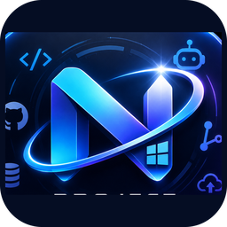
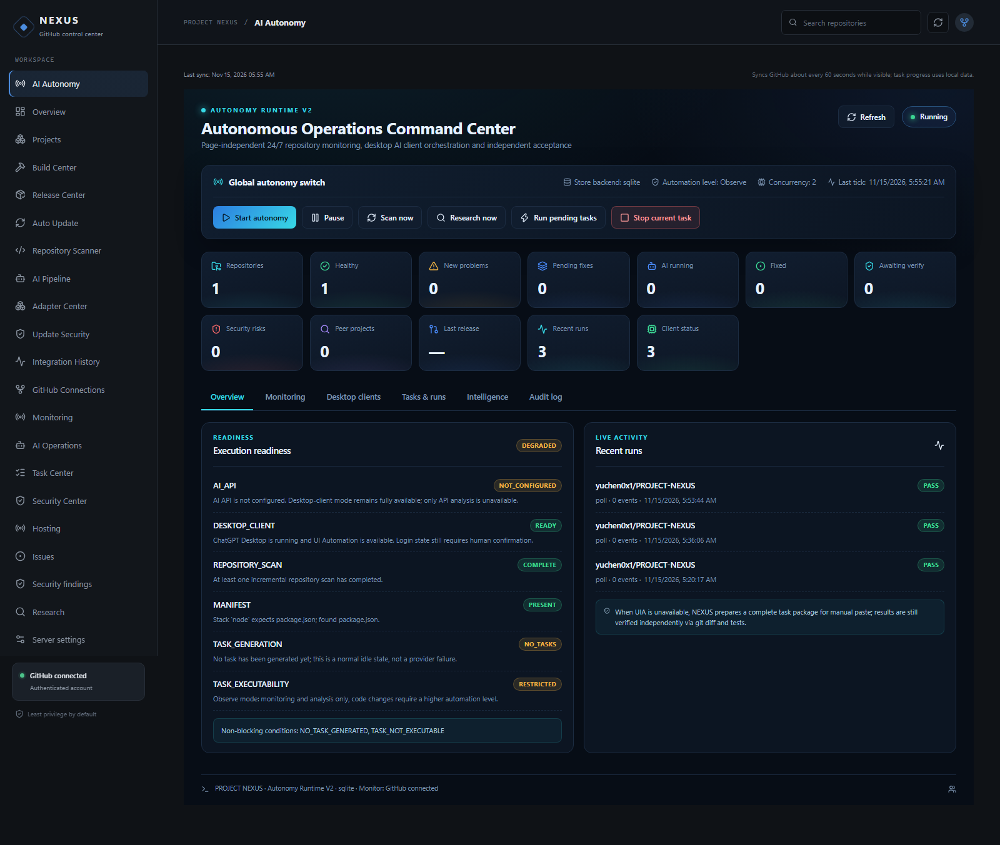

# PROJECT NEXUS

<p align="center">
  
</p>

<p align="center">
  <a href="https://github.com/yuchen0x1/PROJECT-NEXUS/releases/latest"></a>
  
  
  <a href="LICENSE"></a>
  <a href="https://project-nexus.edgeone.dev/"></a>
</p>

**Windows 桌面 AI 仓库研发与运维工作站。** 连接 GitHub、本地项目目录与已安装的桌面 AI 编程客户端，持续监控仓库、主动研究同类开源项目、生成升级建议、在隔离工作区中修复与独立验证，并按授权策略交付变更。

**在线宣传页：[project-nexus.edgeone.dev](https://project-nexus.edgeone.dev/)**（源码在 `website/`）

> **v2.1.1（当前 main）**：在 v2.0 的只读安全边界之上增加了可审计的 Action Intent 授权、统一敏感文件/密钥检测、SQLite/state 备份校验与恢复原语、任务检查点以及完整 i18n/CSS 质量门禁。2.1.1 把这些能力接入真实界面——自动运维中心新增**「安全与恢复」页签**，可直接查看/撤销授权并执行备份创建、校验与状态恢复——同时修复了备份校验路由被误判为写操作而永远 403 的缺陷，并让本地测试与 CI 契约一致。真实 AI Provider、专用测试仓库、Windows VM 和 Authenticode 仍按报告标记为 BLOCKED/NOT TESTED。**v2.1.1 已作为未签名构建公开发布**（Windows x64 安装包、blockmap、`latest.yml`、`SHA256SUMS.txt`；安装包 SHA-256 `128604c1…76c2376`），未削弱 Authenticode 门禁，而是经 PR #28 的 `publish_unsigned` 显式豁免通道发布；发布者身份未验证，SmartScreen 可能告警。发布状态见 [2.1.1 发布报告](docs/PROJECT_NEXUS_2.1.1_RELEASE_REPORT.md)，v2.0.0 验收见 [v2.0.0 验收](docs/POST_RELEASE_ACCEPTANCE_V2.0.0.md)。

## 最新更新

<!-- github-release:start -->

**[v2.1.1](https://github.com/yuchen0x1/PROJECT-NEXUS/releases/tag/v2.1.1)** · 2026-11-23

PROJECT NEXUS 2.1.1 makes the v2.1.0 authorization and backup engine usable from the application, fixes a read-only route that could never succeed, and makes the local regression suite deterministic on developer machines.

[全部发行记录](https://github.com/yuchen0x1/PROJECT-NEXUS/releases)

<!-- github-release:end -->

[查看完整发布记录](docs/releases/release-notes.md)

## 项目定位

用户只需：添加 GitHub 仓库 → 绑定本地目录 → 配置 GitHub 连接与桌面 AI 客户端 → 设置运行周期和权限 → 启动自动运维。此后由 NEXUS 在后台完成监控、分析、任务生成、AI 执行调度、独立验收与受控交付。

**桌面客户端模式不需要 AI API Key**：直接利用 Windows 上已安装、已登录的 ChatGPT Desktop 或 WorkBuddy。传统 API 模式保留且与之独立。

## 核心功能

### 自主运维（v0.9.0 新增，Autonomy Runtime V2）

- **24/7 后台运行**：调度器运行在 Node 服务进程内，窗口最小化到托盘或关闭主窗口都继续工作；服务崩溃自动重启；重启后恢复未完成任务现场。
- **增量仓库监控**：13 类资源（Issues、评论、PR、Review、提交、分支、Release、Actions、安全公告、Dependabot、Code/Secret Scanning、仓库配置），ETag 条件请求、游标续查、分页、事件指纹去重、限流指数退避、Webhook 优先且自动回退轮询。
- **Issue 生命周期**：关闭 ≠ 解决。真实核对关联 PR、合并状态、修复是否进入目标分支、测试、Review、新评论与回归，输出 9 态结论与置信度。
- **持久化调度**：P0–P4 优先级、全局并发上限、同仓库写入互斥、客户端占用管理、任务幂等去重、失败退避、超时终止、暂停/取消/人工接管、append-only 审计日志。
- **桌面 AI 客户端适配器**：ChatGPT Desktop、WorkBuddy、Codex CLI（明确区分同包不同入口）、Generic 配置驱动；独立能力检测表；Windows UI Automation 按窗口/控件识别（不用固定坐标、不用固定 Sleep）；项目归属强制校验；幂等发送；失败截图与可靠人工接管。
- **完整任务包**：仓库信息、base SHA、问题证据、复现方法、预期结果、关联 Issue、同类项目参考、推荐方案、禁止修改项、测试要求、验收标准与文档要求；发送前双重脱敏检查。
- **独立验收**：Git Worktree 隔离（脏工作区直接拒绝）、diff 范围/删除/敏感文件/密钥审查、按项目真实配置探测并执行测试与构建、失败有限轮次重派。
- **发布门禁**：9 项独立条件、patch/minor/major 版本计算、CHANGELOG 生成、内容指纹防止重复发布。
- **同类项目情报**：GitHub Search 发现并持久化、跟踪真实 release/commit/issue/PR、12 项移植分析、开源许可证兼容矩阵。
- **精确就绪诊断**：把「AI API 未配置 / 桌面客户端未连接 / 扫描未完成 / manifest 按技术栈判断 / 任务尚未生成 / 任务不可执行」分开报告，桌面模式不因缺少 API Key 被阻断。
- **指挥中心界面**：首页 12 项真实指标、全局自动运维开关与立即动作、仓库监控、客户端能力表、任务与执行监控、智能研究、审计日志。无演示数据。

### 既有能力（全部保留）

- 七步教学上手、批量仓库托管、十语言界面、深浅色跟随系统。
- Issue 巡检分类、AI 修复流水线、仓库扫描、安全扫描、竞品研究、升级提案。
- 本机 Codex `app-server` 官方桥接、Agent runtime（plan → edit → verify → review）、隔离沙箱。
- 仓库来源档案（Fork/共同提交证据、ZIP 基线三方比较）。
- 应用内自动更新、Draft PR / Release 管理、GitHub App 与 Webhook HMAC。
- 明确授权边界：脚本执行、远程写入、合并发布均需逐项授权。

## 2.0 导航重构：9 个功能中心

2.0 将原来平铺的 21 个顶层页面收拢为 9 个功能中心。**中心只是分组，不是新功能**：每个叶子仍是原有页面组件、原有 API 与原有权限门控，数据库格式、历史数据与隔离 Worktree 均未改变。

| 中心 | 中文名 | 包含的既存页面 |
| --- | --- | --- |
| Dashboard | 总览控制台 | 总览、监控 |
| Repository Center | 仓库中心 | 项目、仓库扫描、Issue 跟踪 |
| AI Autopilot | AI 自主运维 | AI 自动运维、AI Operations、托管 |
| Development Center | 开发与工作流 | 构建中心、AI 流水线 |
| Security Center | 安全与质量 | 安全中心、安全发现、更新安全 |
| Research Center | 智能研究 | 竞品研究 |
| Release Center | 发布与交付 | 发布中心、自动更新 |
| Task Center | 任务与日志 | 任务中心、集成历史 |
| Settings | 系统设置 | 服务器设置、GitHub 连接、适配器中心 |

- 单一注册表 `src/nav/centers.ts` 同时驱动 Web 侧边栏、Electron ActivityBar 与命令面板，三个界面不会各自漂移。
- 叶子标识（如 `Build Center`、`Task Center`）保持稳定，历史导航事件、通知跳转与深链继续有效。
- 回归测试：`tests/unit/navigation-registry.test.ts`（9 中心 / 21 叶子不变量）与 `npm run test:desktop:centers`（真实 Electron 中的中心、叶子与命令面板验收）。

## 系统架构

```
Electron 主进程 (托盘常驻 / 崩溃重启 / DPAPI 凭据)
   └─ Node 服务进程 server/index.mjs (Express, 127.0.0.1:4317)
        ├─ 既有 /api/* 与 60+ services（未改动）
        └─ /api/autonomy/*  ←  server/autonomy/  (Autonomy Runtime V2)
             ├─ engine.mjs        调度与编排
             ├─ monitor.mjs       GitHub 增量监控
             ├─ desktop/          桌面客户端适配器 + UIA 驱动
             ├─ workspace.mjs     Git Worktree 隔离
             ├─ reviewer.mjs      独立验收与发布门禁
             ├─ intelligence.mjs  就绪诊断与同类项目情报
             ├─ db.mjs            SQLite (schema v2) + JSON 降级
             └─ api.mjs           REST + 后台 ticker
React / Vite 前端（9 个功能中心，包含全部 21 个既存页面；见下方「2.0 导航重构」）
```

数据：`data/state.json`（既有 schema v4，不迁移）与 `data/autonomy.db`（新增，独立）。详见 [架构说明](docs/AUTONOMY_V2_ARCHITECTURE.md)。

## 安装方式

[Windows 实测截图：设置、中文及浅色模式](docs/evidence/2026-11-21-windows-settings.png)（开发预览候选，不代表签名更新已验收）。

[查看 Windows x64 发行记录](https://github.com/yuchen0x1/PROJECT-NEXUS/releases)；请选含安装包、blockmap、`latest.yml` 和 `SHA256SUMS.txt` 的版本，并按 SHA256 校验下载内容。v2.0.0 的安装包若未配置 Authenticode 证书会明确标注为未签名，不代表已验证安全更新。发布与验收流程见 [发布管理](docs/RELEASE_MANAGEMENT.md)。

1. 在 Windows 10/11 x64 运行安装程序。
2. 首次启动自动进入教学；之后可从工作台或顶部「一键教学」重看。
3. 配置 GitHub 连接与（可选）AI API。
4. 添加要管理的仓库，绑定本地目录与桌面客户端项目。
5. 设置自动化等级，开启自动运维。

窗口可最小化到托盘继续运行；退出应用或关机后本机任务停止，开机启动由用户在设置中启用。后台是 Electron 管理的 Node 子进程，不安装 Windows 系统服务。

### 开发者运行

需要 Node.js 22+、npm、Git。

```bash
npm ci
npm run desktop:dev
```

网页/API 开发：`npm run dev`；生产后端：`npm run build && npm start`。环境模板见 `.env.example`；`npm start` 不自动加载 `.env`，需要时 `node --env-file=.env server/index.mjs`。默认 API 仅监听 `127.0.0.1:4317`。

## AI 客户端接入方式

| 客户端 | 检测 | 说明 |
| --- | --- | --- |
| ChatGPT Desktop | MSIX 包 `OpenAI.Codex` + 进程 `ChatGPT` | 与同包的 Codex CLI 是不同入口 |
| WorkBuddy | 卸载注册表 + 进程 `WorkBuddy` | 独立安装 |
| Codex CLI / Generic | 进程 / 配置驱动 | 见文档 |

- **无需 AI API Key**：桌面客户端模式直接驱动已登录的客户端。
- 每个仓库单独配置 `agentAdapterId` 与 `agentProjectRef`，发送前强制校验项目归属，不确定即停止。
- 若 UI Automation 不可用或控件无法识别，NEXUS 生成完整任务包并进入人工接管；结果仍由 Git diff 与测试独立验收，不采信 AI 自我报告。
- 传统 API 模式（AI_BASE_URL / AI_API_KEY / AI_MODEL）保留，二者独立。

完整说明：[桌面 AI 客户端接入](docs/AUTONOMY_V2_DESKTOP_CLIENTS.md)。

## GitHub 接入方式

- 应用内 GitHub Token 或 GitHub App 安装；只读监控需要 `repo` / `actions:read` / `security_events:read`。
- 每个仓库可配置监控周期（5/15/30/60 分钟或自定义）、监控项、Webhook 开关。
- Webhook 有效时事件驱动，停止投递后自动回到轮询；既有 `/api/github/webhook` 继续可用。
- 默认不做任何远程写入；PR / 合并 / Release 需显式授权与发布门禁。

完整说明：[GitHub 配置](docs/AUTONOMY_V2_GITHUB_SETUP.md)。

## 自动运维使用方法

指挥中心（导航「系统设置」之前的一级中心「AI 自主运维」）提供：

- **启动 / 暂停 / 恢复**：全局自动运维开关。
- **立即扫描 / 立即研究 / 执行待处理任务 / 停止当前任务**：手动触发。
- **12 项首页指标**：管理仓库、正常仓库、新问题、待修复、AI 执行中、已修复、待验收、安全风险、同类项目更新、最近版本、执行记录、客户端状态。
- **六个页签**：总览（含就绪诊断）、仓库监控、桌面客户端（能力表 + 真实窗口识别）、任务与执行、智能研究、审计日志。

REST 控制示例：

```bash
curl -X POST http://127.0.0.1:4317/api/autonomy/control/scan-now
curl -X POST http://127.0.0.1:4317/api/autonomy/adapters/probe
curl http://127.0.0.1:4317/api/autonomy/overview
```

## 权限设置

| 模式 | 能力 |
| --- | --- |
| `observe`（默认） | 只监控、扫描、分析、生成建议，不改代码 |
| `repair` | 允许隔离分支修改 + 测试；合并与发布需人工确认 |
| `autonomous` | 额外允许符合规则的低风险修复、PR、合并与发布 |

始终需人工确认：删除远程仓库、强推、覆盖未提交修改、删除用户数据、修改凭据、高危安全事件、仓库权限变更、发布有严重问题的版本。自动合并与自动发布是**两个独立开关**。详见 [权限与安全策略](docs/AUTONOMY_V2_PERMISSIONS.md)。

### v2.1 Action Intent

Autonomy 的任何写操作现在都需要一个短期、精确范围的 intent grant；角色本身不会自动授予写权限。默认仍是只读，管理员可在本机 loopback API 中显式授权并随后撤销：

```bash
curl http://127.0.0.1:4317/api/autonomy/intents
curl -X POST http://127.0.0.1:4317/api/autonomy/intents/grant \
  -H "content-type: application/json" \
  -d '{"action":"local_file_write","scope":{"repository":"__global__"},"duration":"once","confirm":true}'
```

每次授权、使用、完成和失败都会进入 append-only `intent_uses`/`audit_log`；高风险 PR、合并、Release 使用独立 action，不会继承低风险授权。

指挥中心的**「安全与恢复」页签**是这套授权与备份能力的图形入口：列出仍有效的授权及其范围与到期时间、一键撤销，并可创建、校验备份或恢复 `state.json`。界面不绕过任何服务端门禁——没有精确授权时与 API 一样返回只读。

### v2.1 数据恢复

`POST /api/autonomy/backups` 会在 SQLite `integrity_check` 与 WAL checkpoint 后生成带 manifest/SHA-256 的备份。恢复前先调用 `/backups/verify`；运行中的服务只允许安全恢复 `state.json`，`autonomy.db` 恢复必须停服务并执行经过验证的恢复流程。

## 常见问题

**没有 AI API Key 能用吗？** 能。桌面客户端模式完全独立，不会因为缺少 API Key 被判为不可用（诊断里 `AI_API` 与 `DESKTOP_CLIENT` 分开报告）。

**为什么任务停在「等待人工接管」？** 通常是 UI Automation 不可用、项目控件无法识别、或项目归属不确定。界面会显示原因与任务包路径；按指引在客户端粘贴任务包后，用「会话处理」标记完成，NEXUS 会独立验收。

**为什么 Issue 关闭了仍显示「无法确认」？** 设计如此。关闭不等于解决，必须有 PR、合并、分支包含、测试、Review 及独立回归测试证据。

**会改动我未提交的代码吗？** 不会。原工作区有任何未提交修改时，任务直接被拒绝；任务只在独立 Git Worktree 的 `nexus/auto/*` 分支进行。

**会自动 push / 发布吗？** 默认不会。需显式开启远程写入、`autoRelease`、`autonomous` 模式与发布批准，且通过全部 9 项门禁。

**监控会重复下载仓库吗？** 不会。ETag 条件请求命中 304 时直接跳过；只处理游标之前的新条目；事件指纹去重。

**数据库在哪？** `%LOCALAPPDATA%\PROJECT NEXUS` 或源码运行的 `data/`：`autonomy.db`（新增）与 `state.json`（既有，未迁移）。

## 截图

<p align="center">
  
</p>

**自动运维指挥中心**（v0.9.0，真实运行截图）：[查看大图](docs/screenshots/autonomy-v2-overview.png) — 12 项实时指标、全局自动运维开关、6 个页签、六类精确就绪诊断与真实扫描记录。

工作台总览：[docs/screenshots/overview.png](docs/screenshots/overview.png)。

### v0.9.0 发布资产

[下载 v0.9.0 Windows x64 安装包与校验文件](https://github.com/yuchen0x1/PROJECT-NEXUS/releases/tag/v0.9.0)（正式 Release，4 个资产：安装包、`.blockmap`、`SHA256SUMS.txt`、`latest.yml`）。

| 文件 | 大小 | 说明 |
| --- | --- | --- |
| `PROJECT-NEXUS-0.9.0-win-x64-setup.exe` | 118 MB | NSIS x64 安装包，**未签名** |
| `PROJECT-NEXUS-0.9.0-win-x64-setup.exe.blockmap` | 127 KB | 增量更新块映射 |
| `SHA256SUMS.txt` | 104 B | SHA-256 校验 |
| `latest.yml` | 371 B | 应用内自动更新清单（0.8.2+ 可直接检查更新升级） |

安装包 SHA-256：`dc96e52721d51ffe902b296c1e5fdd5f0619ed145a8fea7f419c140110acc999`

本地重新构建（本次因 `release/win-unpacked` 被运行中的旧实例占用，改用独立输出目录）：

```bash
npm run build
npx electron-builder --win nsis --x64 --publish never -c.directories.output=release-v090
```

`release-v090/` 与历史 `release/` 均由 `.gitignore` 忽略，不进版本库。

## 测试方法

```bash
npm run check          # typecheck + lint + 全量单元测试 + 构建
npm run i18n:audit     # 十语言审计
npm run i18n:coverage  # 翻译覆盖率
node tests/autonomy-live-github.mjs   # 真实 GitHub 只读 + 真实 UIA 验收（需 GITHUB_TOKEN）
```

真实测试记录：[测试报告](docs/AUTONOMY_V2_TEST_REPORT.md)、`docs/evidence/autonomy-v2-live-acceptance.json`、`docs/evidence/autonomy-v2-full-test.log`。

`tests/v1-live-acceptance.mjs` 需要真实 GitHub/AI 凭据与严格命名的临时测试仓库，**会写入该仓库**，不得指向业务项目。

## 未来规划

- 完成控件级桌面客户端自动化的真实端到端验证与客户端控件指纹库。
- 集成与项目技术栈匹配的安全工具链（CodeQL / Semgrep / Gitleaks / npm audit 等）。
- 引入专门的静态 Bug 分析引擎与更深的质量评分模型。
- 完善同类项目相关性量化评分与自动升级建议优先级。
- 新增指挥中心页面的完整十语言文案。
- 真实 24 小时浸泡运行与完整远程交付闭环验收。
- 签名安装包与更严格的隔离宿主。

## 文档

- [现状审计](docs/AUTONOMY_V2_BASELINE_AUDIT.md) · [新版架构](docs/AUTONOMY_V2_ARCHITECTURE.md) · [更新日志](CHANGELOG.md)
- [桌面客户端接入](docs/AUTONOMY_V2_DESKTOP_CLIENTS.md) · [GitHub 配置](docs/AUTONOMY_V2_GITHUB_SETUP.md) · [权限](docs/AUTONOMY_V2_PERMISSIONS.md)
- [数据库迁移](docs/AUTONOMY_V2_DATABASE.md) · [测试报告](docs/AUTONOMY_V2_TEST_REPORT.md) · [安全审计](docs/AUTONOMY_V2_SECURITY_AUDIT.md) · [已知限制](docs/AUTONOMY_V2_LIMITATIONS.md)
- [用户指南](docs/USER_GUIDE.md) · [安全说明](docs/SECURITY.md) · [完整发布记录](docs/releases/release-notes.md)

## 许可证

[MIT](LICENSE) © 2026 冷漠不是神 (yuchen0x1)


## 2026-11-16 项目演进审计

本轮以 v0.9.2 为基线完成了真实代码审计、16 个开源项目对标和 36 项升级路线图。已落地的变更包括：API 请求追踪 ID、安全响应头、单进程速率保护、结构化 API 404/错误边界、HTTP 超时、15 候选竞品研究、研究并发池与 prompt 预算、Web/Electron 入口按需加载，以及 GitHub PAT/App 状态分层。

- [项目现状审计](PROJECT_AUDIT.md)
- [竞品对标分析](COMPETITOR_ANALYSIS.md)
- [36 项升级路线图](UPGRADE_ROADMAP.md)
- [本轮升级交付报告](UPGRADE_REPORT.md)

本轮没有推送、创建 PR、发布或部署；签名更新、严格 Windows 隔离、真实外部工具扫描、远程写入和 24 小时 soak 仍按 BLOCKED/PARTIAL 记录。
