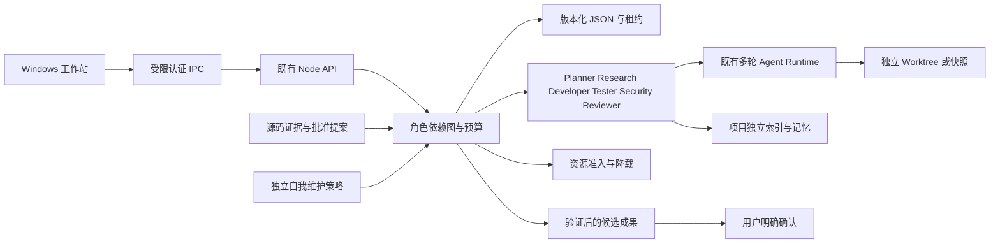

# 渐进式架构升级

本地分支基于 0.7.0。保留 Electron、Preload、React、Node、Provider、34 工具与工作区适配器。新增服务通过受认证回环 API 接入；运行数据留在已有数据目录的 evolution 子目录，不引入数据库或系统服务。

每个角色获得新的上下文，仅接收同一工作流的依赖结果和明确提供的证据；没有模型自行递归调用角色的工具。调度器固定并发、总预算、重试次数和超时。Developer 复用原工作区执行管线，Tester、Security 和 Reviewer 分别形成独立记录。已确认结果持久化并附摘要；缺失测试或独立审查不得仲裁成功。

事务边界分开：角色完成、候选版本完成、应用到项目、安装到运行实例、远程发布互不等价。普通项目策略不授权自我维护安装。未知远端结果先核对既有回执；未知写入步骤不自动重放。仅在原检查点验证通过且写入结果明确时续跑安全步骤。

新存储使用已有原子写/fsync/备份与跨进程租约。不把租约或 Job Object 当成 OS 安全沙箱。严格模式缺少已验证执行宿主时必须阻断；更新缺少受信任发布者签名时不得安装。

当前这是实施架构，接线与验证状态见 [实施进度](ULTIMATE_EVOLUTION_PROGRESS.md)；不得据此宣称全部路径已经真实验收。
