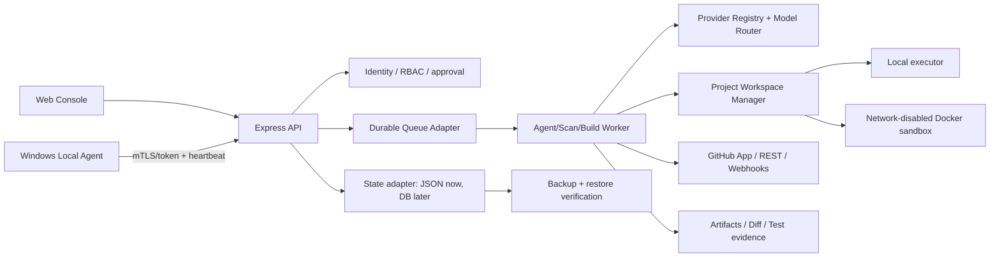

# PROJECT NEXUS Ultimate Architecture

## 1. 目标架构

NEXUS 采用“Web 控制中心 + 统一后端 + 可选 Windows Agent + 项目隔离执行器”的增量架构。当前代码保持 React/Vite + Express 模块化单体，不进行推倒重写；新增能力必须沿现有服务边界接入。

## 2. AgentRun 状态机

当前 AI integration job 已开始记录 AgentRun phase、attempt、checkpoint 和 bounded events；完整实现仍需将所有自主开发任务统一到可恢复状态机，而不是单次 LLM 请求：

`QUEUED → CONTEXT → PLAN → TOOL_EXECUTION → OBSERVE → DIAGNOSE → REPAIR → VERIFY → REVIEW → DELIVERED`

任何状态都可以进入 `CANCEL_REQUESTED`、`FAILED` 或 `BLOCKED`。每次状态变化写入 append-only event，保存输入摘要、工具名、退出码、截断后的输出、checkpoint 和风险级别；密钥、完整仓库敏感内容和 provider Authorization 永不写入事件。

工具分为四级：

1. `READ_ONLY`：仓库目录、文件、Git 状态、扫描报告。
2. `LOCAL_MUTATION`：隔离 workspace 内的受限文件操作。
3. `BUILD_TEST`：受资源/超时/网络策略限制的本地或 Docker 执行。
4. `REMOTE_WRITE`：推送、PR、Release、生产部署；必须有角色、精确目标、审批和审计证据。

## 3. Provider 与模型路由

Provider registry 负责配置、能力、健康状态和成本元数据；业务代码只请求任务角色（analysis、coding、fix、review、docs、test），由 router 根据能力、上下文长度、速度、成本、预算和 fallback 顺序选择模型。Provider adapter 负责协议差异，统一输出：

- request id、provider/model、开始/结束时间；
- prompt/completion token（没有真实 usage 时标记 unknown）；
- retry/timeout/abort 状态；
- redacted error；
- 估算成本和成本来源。

API key 只从服务端 secret/env 读取；前端只能看到 provider id、host、model、配置状态和非敏感能力。

## 4. 项目隔离与工作区事务

每个项目/任务使用独立目录、分支、日志和资源预算。路径检查必须包含 lexical containment、realpath containment、符号链接拒绝、`.git`/secret 文件拒绝和文件大小/数量限制。

文件修改采用事务语义：

1. 记录 base commit、目标文件清单和哈希。
2. 将原始文件备份到任务目录的受控 backup 区。
3. 预验证所有操作，再一次性应用。
4. 运行 diff、语法/测试和策略检查。
5. 失败时按 backup 恢复；成功时保留 patch、测试输出和审批记录。

## 5. Workflow 与发布

Workflow 是持久化的 DAG/步骤列表，至少包含 `timeout`、`retryPolicy`、`concurrencyGroup`、`failFast`、`requiresApproval` 和 `artifactRetention`。Release 只能从绿色构建、测试、资产 digest、签名验证、审批和目标环境保护规则全部通过后进入正式发布。

自动更新证据分层：

1. 代码接入存在；
2. CI 生成资产；
3. manifest/digest/signature 可验证；
4. 草稿 Release 已创建；
5. 旧客户端真实下载、安装、启动并上报成功。

只有第 5 层才是“更新闭环完成”。

## 6. 存储演进

当前 JSON 状态继续作为单机兼容层，不因追求架构升级而盲目引入 PostgreSQL/Redis。先抽象 `StateStore`、`QueueStore`、`EventStore` 接口，补齐备份/恢复和并发检测；当需要多实例、审计保留、查询/锁/队列超过 JSON 能力时，再以可回滚迁移切换数据库。
