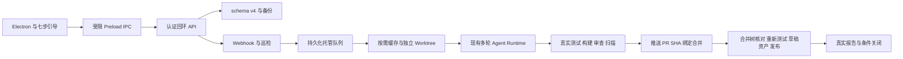

> Current changes: [0.4.0 report](ORDERED_UPGRADE_REPORT.md). The sections below describe the 0.3.0 baseline.

# v1.0 增量架构 · 2026-11-13

基于 v0.3.0 工作区及已有未提交实现增量开发，复用 Electron、React、Node、Agent Runtime 和 JSON 存储。

| 模块 | 职责 |
| --- | --- |
| desktop/main.mjs、preload.cjs | 原生窗口、托盘、子进程、DPAPI、认证 IPC、自启设置 |
| src/desktop/SetupCenter.tsx | 七步设置与显式远程写入授权，不持久化明文密钥 |
| server/index.mjs | 连接器、路由、Webhook/轮询、编排和应用级写入开关 |
| hosted-queue.mjs | Job ID、Issue 去重、优先级、排队恢复、运行中断标记 |
| repo-workspace.mjs | 按需缓存、网络代理继承、单仓库互斥、路径/脏缓存保护 |
| agent/* | 多轮执行、审批、上下文、命令、隔离适配器和独立审查 |
| issue-fix-pipeline.mjs | Issue 到真实修改、测试、安全扫描、分支和 PR |
| delivery-stage.mjs | 证据门禁、SHA 绑定、合并树一致、重新测试、草稿上传、校验和、关闭条件 |
| competitor-research.mjs | 搜索与 README/源码/提交/Issue/PR/许可证证据，AI 或明确 metrics-only 分析 |
| state-store.mjs | v1–v4 兼容、原子状态、有效副本、不含短期 token 的迁移快照 |

任务先持久化再执行。同仓库排队，不同仓库有限并行；当前锁仅在单进程有效。后台不依赖 React 页面存活，但仍由 Electron 管理，未安装系统服务。

运行中断可能发生在 GitHub 已接受请求、尚未写下回执之时，因此转为 Interrupted 并保留现场，不自动重放。排队任务重启恢复；远端自动核对和精确步骤续执行未完成。

桌面 API 使用随机会话 token、回环绑定、CORS/CSP 与受限 IPC。本机原生命令仍使用当前 Windows 用户权限，不是系统级沙箱。
